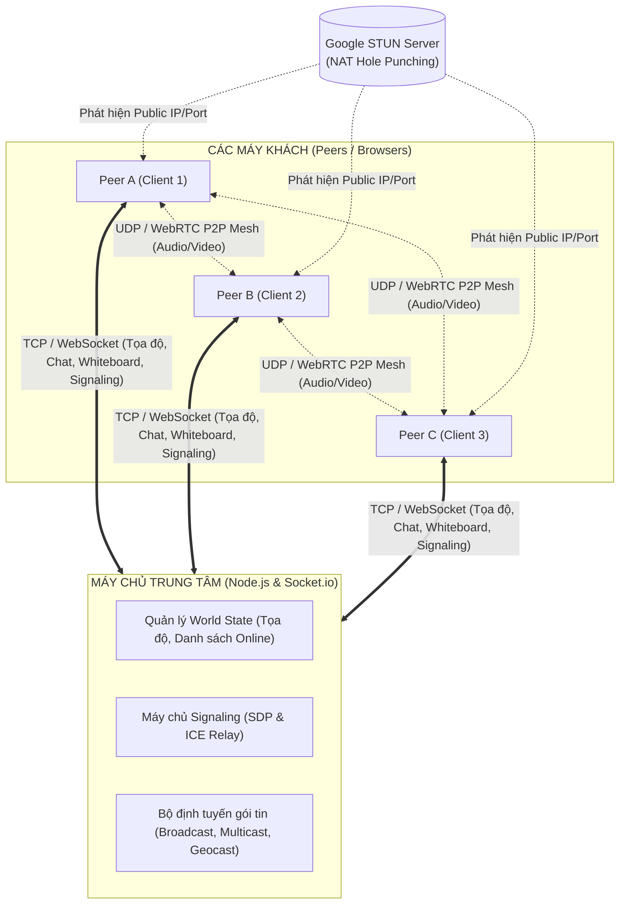

# 🌐 Gather Space - Gather.town Clone
> **Đồ Án Môn Học: Lập Trình Mạng (Network Programming)**  
> **Kiến trúc mạng:** Hybrid Architecture (Client-Server Signaling & State + P2P Mesh Real-time Media)  
> **Giao thức cốt lõi:** TCP (WebSocket / Socket.io) & UDP (WebRTC / SRTP)

---

## 📌 1. GIỚI THIỆU TỔNG QUAN DỰ ÁN (Project Overview)

**Gather Space** là ứng dụng không gian làm việc và hội họp ảo thời gian thực 2D (lấy cảm hứng từ Gather.town). Dự án được thiết kế không chỉ nhằm mục đích xây dựng một sản phẩm cộng tác trực tuyến trực quan, mà cốt lõi là một **phòng thí nghiệm Lập trình Mạng thu nhỏ**, mô phỏng và giải quyết các bài toán kinh điển trong truyền thông mạng máy tính:
- Quản lý đồng bộ trạng thái thực thể phân tán (*Distributed State Synchronization*).
- Định tuyến gói tin theo ngữ cảnh không gian (*Spatial Geocasting*) và phân nhóm logic (*Application Multicast*).
- Tối ưu hóa băng thông bằng mô hình lai (*Hybrid Architecture*) và cơ chế giảm tải máy chủ (*Bandwidth Offloading*).
- Vượt tường lửa và đục lỗ NAT (*NAT Traversal / Hole Punching*).

### 🚀 Các tính năng chính của sản phẩm
- **Không gian ảo 2D tương tác:** Bản đồ văn phòng đa phòng ban (Sảnh lễ tân, Phòng họp lớn, Phòng họp nhỏ, Quầy pantry, Phòng làm việc chung...).
- **Đồng bộ hóa chuyển động thời gian thực:** Nhân vật di chuyển mượt mà trên lưới tọa độ, đồng bộ trạng thái giữa tất cả các máy khách.
- **Trò chuyện linh hoạt (Chat System):** Hỗ trợ chat toàn hệ thống (Global/Broadcast) và chat theo khoảng cách vị trí (Nearby / Spatial Chat).
- **Hội nghị truyền hình P2P (Video/Audio Conference):** Tự động kích hoạt luồng camera/mic khi các nhân vật bước vào cùng một phòng họp hoặc thảm họp nhóm.
- **Bảng vẽ cộng tác (Collaborative Whiteboard):** Chia sẻ nét vẽ trực tiếp với độ trễ tối thiểu và tính toàn vẹn cao.

---

## 🏗️ 2. KIẾN TRÚC MẠNG & NGUYÊN LÝ HOẠT ĐỘNG (Network Architecture)

Hệ thống triển khai **Mô hình Kiến trúc Lai (Hybrid Architecture)**, phối hợp chặt chẽ giữa hai tầng giao vận **TCP** và **UDP** để tối ưu hóa hiệu năng và độ tin cậy.



---

### 2.1. Hai Giao Thức Tầng Giao Vận Cốt Lõi (Transport Layer: TCP vs UDP)

| Tiêu chí | Giao thức TCP (qua WebSocket) | Giao thức UDP (qua WebRTC) |
| :--- | :--- | :--- |
| **Bản chất tầng mạng** | Đảm bảo tin cậy 100%, đúng thứ tự, kiểm soát tắc nghẽn (*Reliable & Ordered*). | Tốc độ cao, độ trễ cực thấp, chấp nhận mất gói nhẹ (*Unreliable, Low Latency*). |
| **Áp dụng trong dự án** | - Tọa độ bước đi nhân vật<br>- Tin nhắn văn bản (Chat)<br>- Tọa độ nét vẽ bảng trắng (Whiteboard)<br>- Thông điệp Signaling bắt tay WebRTC | - Luồng Video trực tiếp từ Webcam<br>- Luồng Âm thanh (Audio) từ Microphone |
| **Lý do thiết kế** | Nếu dùng UDP, nét vẽ bảng trắng sẽ bị đứt đoạn, tin nhắn bị mất ký tự, nhân vật bị dịch chuyển sai lệch vị trí nghiêm trọng. | Media thời gian thực không thể chờ cơ chế retransmit (truyền lại) của TCP vì sẽ gây hiện tượng trễ lũy kế (Head-of-Line blocking), làm méo giọng hoặc giật khung hình. |

---

### 2.2. Hai Mô Hình Kiến Trúc Phối Hợp (Hybrid Model)

1. **Mô hình Client - Server (Mô hình Xương sống):**
   - Máy chủ Node.js đóng vai trò điều phối tập trung.
   - Lưu trữ và duy trì **Trạng thái Thế giới (World State)**: Theo dõi danh sách người dùng đang trực tuyến, tọa độ $(X, Y)$, trạng thái vào/ra các phòng.
   - Đóng vai trò là **Signaling Broker (Bà mối kết nối)**: Trung gian luân chuyển thông điệp thiết lập kết nối trước khi các máy khách bắt tay trực tiếp.
2. **Mô hình Peer-to-Peer Mesh (P2P Ngang hàng):**
   - Áp dụng khi người dùng bước vào cùng một phòng họp nhóm (tối đa 4–6 người).
   - Các máy khách thiết lập liên kết trực tiếp `RTCPeerConnection` theo cấu trúc lưới (Full Mesh).
   - **Mục đích mạng:** Giảm tải băng thông (*Bandwidth Offloading*) cho máy chủ trung tâm xuống mức $0\text{ MB/s}$ đối với dữ liệu âm thanh và hình ảnh dung lượng lớn.

---

### 2.3. Các Phương Thức Định Tuyến Gói Tin (Packet Routing Methods)

Hệ thống triển khai 3 cấp độ định tuyến gói tin ở tầng ứng dụng:

```
[Packet Routing Tree]
├── 1. Broadcast              --> Phát tán toàn bộ mạng (All Sockets)
├── 2. Application Multicast  --> Phân nhóm theo Room / Zone (Room Sockets)
└── 3. Spatial Geocasting     --> Định tuyến theo bán kính Euclid (Distance <= R)
```

1. **Broadcast (Phát sóng toàn mạng):**
   - *Cơ chế:* Server phân phối gói tin tới tất cả socket đang kết nối trong namespace.
   - *Áp dụng:* Thông báo bảo trì từ hệ thống, sự kiện người chơi mới gia nhập không gian, chat kênh `To: Everyone`.
2. **Application-Layer Multicast (Đa bá tầng ứng dụng / Phân nhóm Room):**
   - *Cơ chế:* Sử dụng cơ chế Room/Channel logic của Socket.io. Khi nhân vật bước vào tọa độ của một phòng cụ thể (ví dụ *Room 5: Phòng họp lớn*), Server tự động gán Socket ID vào nhóm `room_5`.
   - *Áp dụng:* Dữ liệu nét vẽ bảng trắng, thông báo trạng thái riêng của phòng, tín hiệu mời họp.
   - *Lợi ích:* Cô lập luồng dữ liệu (*Network Isolation*), tiết kiệm băng thông khi không gửi nhầm dữ liệu sang các phòng khác.
3. **Geocasting / Spatial Multicast (Định tuyến theo không gian địa lý):**
   - *Cơ chế:* Khi người dùng gửi tin nhắn hoặc phát tín hiệu ở kênh "Nearby", Server tính toán khoảng cách Euclid với các socket khác:
     $$d(A, B) = \sqrt{(x_B - x_A)^2 + (y_B - y_A)^2}$$
     Gói tin chỉ được đóng gói và gửi tới các Socket thỏa mãn điều kiện $d(A, B) \le R_{\text{nearby}}$ (ví dụ: $R = 150\text{px}$).

---

### 2.4. Kỹ Thuật Kiểm Soát & Tối Ưu Mạng (Network Control & Optimization)

> [!IMPORTANT]
> Đây là các giải pháp kỹ thuật cốt lõi giúp hệ thống chống chịu tải và quản lý tài nguyên mạng hiệu quả:

1. **Kỹ thuật Throttling (Chống nghẽn mạng - Packet Flooding Prevention):**
   - Khi người chơi giữ phím di chuyển, vòng lặp game loop render ở tốc độ 60 FPS. Nếu gửi socket liên tục 60 lần/giây cho hàng trăm người dùng, mạng sẽ tắc nghẽn và server quá tải.
   - **Giải pháp:** Phía Client tích hợp bộ lọc Throttle, gộp tọa độ và chỉ phát tín hiệu cập nhật lên mạng tối đa **30 lần/giây (30Hz)** hoặc khi người chơi đổi hướng di chuyển.
2. **Giao thức Nhịp tim (Heartbeat / Keep-Alive Protocol):**
   - Máy chủ và Máy khách trao đổi định kỳ các gói tin Ping - Pong kích thước nhỏ mỗi $5\text{ giây}$.
   - **Mục đích:** Phát hiện tức thì các sự cố "rớt mạng im lặng" (*Silent Disconnection* như rút dây mạng LAN, mất sóng Wi-Fi, sập nguồn máy tính). Khi quá thời gian `pingTimeout`, Server lập tức thu hồi socket, giải phóng bộ nhớ và gửi bản tin thông báo cho các người chơi khác xóa nhân vật khỏi bản đồ.
3. **Đặc tả Giao thức Tầng Ứng Dụng (Application Layer Protocol Design):**
   - Dữ liệu trao đổi qua WebSocket tuân thủ cấu trúc JSON Envelope chuẩn hóa:
   ```json
   {
     "header": {
       "type": "PLAYER_MOVE",
       "senderId": "usr_9x28fa",
       "timestamp": 1732515000000
     },
     "payload": {
       "x": 450,
       "y": 280,
       "direction": "down",
       "isMoving": true
     }
   }
   ```

---

### 2.5. Kỹ Thuật Xuyên Tường Lửa (NAT Traversal & Signaling)

Hầu hết máy tính cá nhân đều nằm sau Router Wi-Fi với địa chỉ IP riêng (*Private IP*). Để thiết lập luồng kết nối P2P giữa hai máy ở hai mạng khác nhau:

1. **NAT Hole Punching qua STUN Server:**
   - Ứng dụng tích hợp máy chủ công cộng của Google: `stun:stun.l.google.com:19302`.
   - Máy khách gửi yêu cầu đến STUN Server để phát hiện **Địa chỉ IP công cộng (Public IP)** và **Cổng mở ngoài (Public Port)** được NAT gán cho nó.
2. **Quy trình Bắt tay Báo hiệu (Signaling Handshake qua WebSocket):**
   - *Bước 1 (SDP Offer/Answer):* Peer A khởi tạo mô tả phiên kết nối (SDP Offer gồm codec, độ phân giải media) gửi lên Server Node.js qua WebSocket. Server chuyển tiếp gói tin đến Peer B. Peer B phản hồi lại bằng SDP Answer.
   - *Bước 2 (ICE Candidate Gathering):* Cả hai bên thu thập danh sách các "ứng viên kết nối" (ICE Candidates: IP nội bộ, IP công cộng từ STUN) và chuyển đổi qua đường ống Signaling.
   - *Bước 3 (P2P Handshake):* Khi bắt tay thành công, luồng Media UDP trực tiếp được thiết lập xuyên qua NAT mà không cần qua Server.

---

## 🎯 3. BẢNG CHEAT SHEET BẢO VỆ ĐỒ ÁN (Defense Cheat Sheet)

Bảng tổng hợp nhanh đối chiếu giữa tính năng ứng dụng và kiến thức Lập trình mạng chuyên sâu:

| Tính năng trên Web | Kỹ thuật / Giao thức Mạng sử dụng | Giải quyết bài toán mạng gì? |
| :--- | :--- | :--- |
| **Di chuyển nhân vật 2D** | TCP, WebSocket, Throttling (30Hz) | Bảo đảm tính nhất quán vị trí, chống bão gói tin (*Packet Flooding*). |
| **Phân chia phòng họp, bước vào thảm** | TCP, Application Multicast (Room/Zone) | Cô lập dữ liệu theo ngữ cảnh, đa bá theo nhóm đối tượng (*Group Multicast*). |
| **Chat lân cận "Nearby"** | TCP, Geocasting (Khoảng cách Euclid) | Định tuyến gói tin động dựa trên không gian tọa độ vật lý của người dùng. |
| **Gọi Video/Audio họp nhóm** | UDP, WebRTC, P2P Mesh Topology | Giảm tải băng thông máy chủ trung tâm (*Bandwidth Offloading*), độ trễ $<100\text{ms}$. |
| **Kết nối giữa 2 máy khác mạng Wi-Fi** | Google STUN, NAT Traversal, SDP Signaling | Đục lỗ NAT, vượt tường lửa để tìm địa chỉ IP công cộng và bắt tay kết nối. |
| **Phát hiện người dùng mất mạng** | TCP, Ping/Pong Heartbeat Protocol | Quản lý vòng đời kết nối, giải phóng tài nguyên bộ nhớ và dọn dẹp avatar "ma". |
| **Bảng vẽ chung Whiteboard** | TCP, JSON/Binary Serialization | Đồng bộ tuần tự các nét vẽ, bảo toàn tính toàn vẹn dữ liệu (*No Packet Loss*). |

---

## 💻 4. CÔNG NGHỆ & CẤU TRÚC THƯ MỤC DỰ ÁN

### 4.1. Ngăn xếp công nghệ (Tech Stack)
- **Frontend:** HTML5, CSS3, Vanilla JavaScript, HTML5 Canvas API (render bản đồ và nhân vật), WebRTC W3C API.
- **Backend:** Node.js, Express.js (HTTP Server phục vụ tĩnh), Socket.io (WebSocket Engine quản lý kết nối và Room).
- **Network Services:** Google STUN Server (`stun.l.google.com:19302`).
- **Data Persistence:** SQLite / File-based JSON Database (Lưu trữ thông tin phòng, người dùng, lịch sử chat).

### 4.2. Cấu trúc thư mục định hướng (Architecture Structure)

```
Gather Space/
├── client/                     # Mã nguồn giao diện người dùng (Frontend SPA)
│   ├── assets/                 # Tài nguyên đồ họa, âm thanh và metadata
│   │   ├── audio/              # File âm thanh hiệu ứng (bước chân, v.v.)
│   │   ├── characters/         # Sprite 10 nhân vật pixel art
│   │   └── office_master_blueprint.png # Bản đồ mặt bằng tổng thể 3840x3072
│   ├── app.js                  # Điều khiển giao diện, Socket.io client & WebRTC UI
│   ├── characters.js           # Cấu hình danh sách nhân vật
│   ├── index.html              # Giao diện chính (Prejoin & Virtual Space)
│   ├── mapEngine.js            # Engine Canvas 2D, Pathfinding & Proximity
│   ├── styles.css              # Giao diện Gather Town UI CSS
│   ├── webrtcManager.js        # Quản lý kết nối WebRTC P2P Mesh
│   └── whiteboard.js           # Bảng vẽ cộng tác thời gian thực
│
├── server/                     # Máy chủ điều phối Node.js / Express / Socket.io
│   ├── server.js               # Khởi tạo HTTP, WebSocket & REST API
│   ├── core/
│   │   ├── geocastRouter.js    # Định tuyến gói tin theo khoảng cách Euclid
│   │   └── worldState.js       # Quản lý trạng thái phân tán người dùng
│   ├── database/
│   │   ├── data.json           # Dữ liệu phòng & lịch sử chat
│   │   └── db.js               # Tầng tương tác dữ liệu
│   └── handlers/
│       ├── chatHandler.js      # Xử lý tin nhắn chat toàn hệ thống & lân cận
│       ├── movementHandler.js  # Đồng bộ di chuyển & Throttling 30Hz
│       ├── roomHandler.js      # Phân chia phòng & Multicast
│       ├── signalHandler.js    # Bắt tay WebRTC Signaling & Proximity Call
│       └── whiteboardHandler.js# Đồng bộ bảng vẽ cộng tác
│
├── scripts/                    # Công cụ xây dựng và kịch bản tự động
│   ├── build_master_map.js     # Script dựng và xuất bản đồ blueprint 3840x3072
│   └── archive/                # Lưu trữ các kịch bản kiểm thử & công cụ phát triển
│
├── resources/                  # Tài nguyên thiết kế gốc (Raw Asset Source)
│   ├── Background/             # Sprite pack CornerCafe
│   └── Nhanvat/                # Bộ frame gốc của nhân vật
│
├── docs/                       # Tài liệu hướng dẫn & thuyết minh đồ án
│   ├── HUONG_DAN_BAO_VE.md     # Kịch bản demo 5 phút & hướng dẫn bảo vệ 9-10đ
│   └── ROADMAP.md              # Lộ trình hoàn thiện 6 Phase của dự án
│
├── .gitignore                  # Cấu hình bỏ qua file rác và node_modules
├── package.json                # Quản lý thư viện phụ thuộc & lệnh npm
└── README.md                   # Tài liệu đặc tả kỹ thuật đồ án
```

---

## 🛠️ 5. HƯỚNG DẪN CÀI ĐẶT & CHẠY THỬ NGHIỆM (Quick Start)

### 5.1. Yêu cầu môi trường
- Đã cài đặt **Node.js** (phiên bản `18.x` trở lên) và **npm**.
- Trình duyệt hiện đại hỗ trợ WebRTC & HTML5 Canvas (Google Chrome, Microsoft Edge, Firefox).

### 5.2. Các bước khởi chạy

1. **Cài đặt thư viện:**
   ```bash
   npm install
   ```

2. **Khởi động hệ thống:**
   ```bash
   npm start
   # Server lắng nghe mặc định tại: http://localhost:3000
   ```

3. **Thử nghiệm tính năng mạng nội bộ (Multi-Tab Testing):**
   - Mở Tab 1 tại: `http://localhost:3000` -> Chọn nhân vật A, nhập tên "User 1", bật Mic/Cam và vào sảnh.
   - Mở Tab 2 (hoặc Cửa sổ ẩn danh) tại: `http://localhost:3000` -> Chọn nhân vật B, nhập tên "User 2".
   - **Kiểm tra TCP:** Di chuyển nhân vật ở Tab 1, quan sát Tab 2 thấy nhân vật di chuyển tức thì theo thời gian thực. Thử gửi tin nhắn chat và vẽ bảng trắng.
   - **Kiểm tra UDP & WebRTC:** Di chuyển cả 2 nhân vật bước vào cùng một phòng họp (ví dụ *Phòng họp lớn*). Quan sát khung video WebRTC tự động kết nối và hiển thị luồng webcam trực tiếp giữa 2 tab.
   - **Kiểm tra Geocasting:** Đi ra xa nhau (> 200px) và thử gửi tin nhắn "Nearby", kiểm tra xem bên kia có nhận được không. Đi lại gần và thử lại.
   - **Kiểm tra Heartbeat:** Tắt đột ngột Tab 1, quan sát sau khoảng 5 giây Tab 2 sẽ tự động nhận được sự kiện ngắt kết nối và xóa nhân vật User 1 khỏi bản đồ.

---

> [!NOTE]
> Dự án được xây dựng với mục tiêu phục vụ báo cáo và bảo vệ đồ án môn học. Toàn bộ mã nguồn mạng được viết tường minh, có chú thích giải thích chi tiết từng cơ chế để thuận tiện cho việc trình bày trước hội đồng phản biện.
